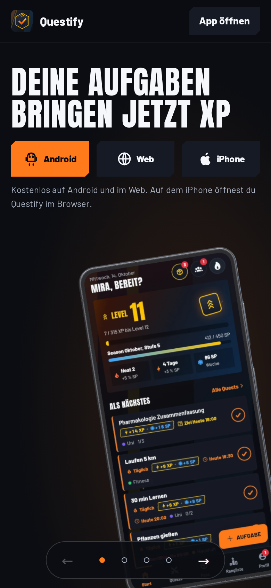
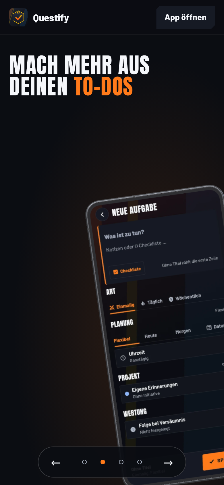
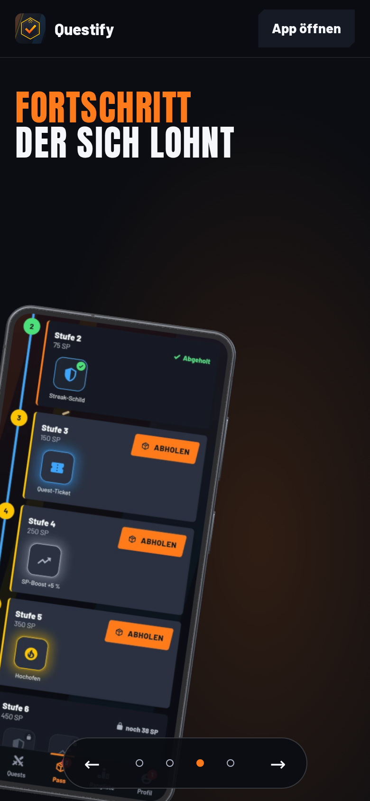
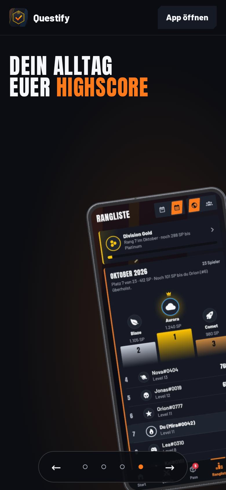
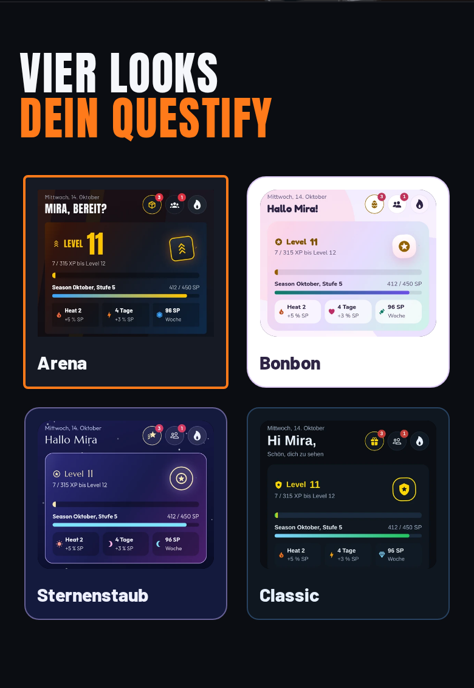
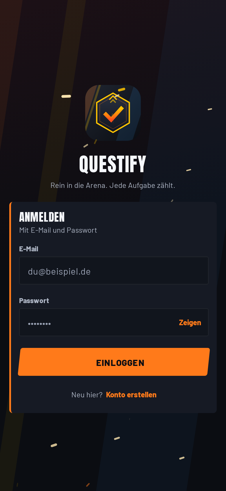

# Questify

Questify is a German to-do app for Android and the web. Finished tasks earn XP, levels and points in weekly and monthly leagues against your friends.

<p>
  
  
  
  
</p>

Screenshots: the public landing page, mobile viewport, taken with Playwright on 30 Oct 2026. The phone screens show seed data from the app's test fixtures. Mira and her friends are not real users, and visitors cannot use that data.

## Try it

- Web: https://mastertasker.expo.app/ (sign up with email and password)
- Android: [questify.apk, latest release](https://github.com/vassiljevnikita-sudo/questify-releases/releases/latest/download/questify.apk) (version 1.1.0, about 102 MB)
- Landing page: https://mastertasker.expo.app/willkommen/

## My role

Nikita Vassiljev ([GitHub](https://github.com/vassiljevnikita-sudo)), solo developer: concept, app code, design and releases. I built it with AI coding agents (Claude and OpenAI Codex).

## Tech stack

- TypeScript; two small native Android modules in Kotlin (launcher icon per look, haptic patterns)
- React Native and Expo with Expo Router; React Native Web for the web build
- TanStack Query for server state, Reanimated for animation
- Supabase (Postgres, Auth)
- Tests: Vitest and Playwright
- Hosting: web on EAS Hosting (`*.expo.app`), Android APK on GitHub Releases

Exact versions of every dependency are in [docs/ARCHITECTURE.md](docs/ARCHITECTURE.md).

## Limitations

- The source code is private. This repository holds the Android builds, the screenshots and the stack list.
- Android only as an APK outside Google Play, so Android asks you to allow the install. There is no native iOS app; on an iPhone, use the web app in the browser.
- The interface is German only.
- You need an account. The web app has no guest or demo mode; the seed data in the screenshots is not reachable from the live app.
- Solo project: no external security audit, no uptime guarantee.

## Install on Android

1. Open the [APK link](https://github.com/vassiljevnikita-sudo/questify-releases/releases/latest/download/questify.apk) on your Android phone.
2. Open the downloaded `questify.apk`. Android asks whether the browser (or file manager) may install apps. Allow it for this install.
3. Tap Install, open Questify and sign in or create an account.

To update, install the newer APK over the old one. Your quests and progress are stored on the server, so nothing is lost.

Each release also has a `SHA256SUMS` file. To check a download on a computer:

```bash
sha256sum questify.apk   # compare with the line in SHA256SUMS on the release page
```

## Releases

| Version | Date | Notes |
| --- | --- | --- |
| [1.1.0](https://github.com/vassiljevnikita-sudo/questify-releases/releases/tag/v1.1.0) | 19 Oct 2026 | Expo SDK 57, four looks, collection and cosmetics, reusable friend invites |
| [1.0.0](https://github.com/vassiljevnikita-sudo/questify-releases/releases/tag/v1.0.0) | 19 Oct 2026 | First public Android build |

## More screens

<p>
  
  
</p>

Left: the same start screen in the four looks (Arena, Bonbon, Sternenstaub, Classic). Right: the web app's sign-in page.

## Contact

vassiljev.nikita@gmail.com · [Impressum](https://mastertasker.expo.app/website/5/impressum.html) · [Datenschutz](https://mastertasker.expo.app/website/5/datenschutz.html)
